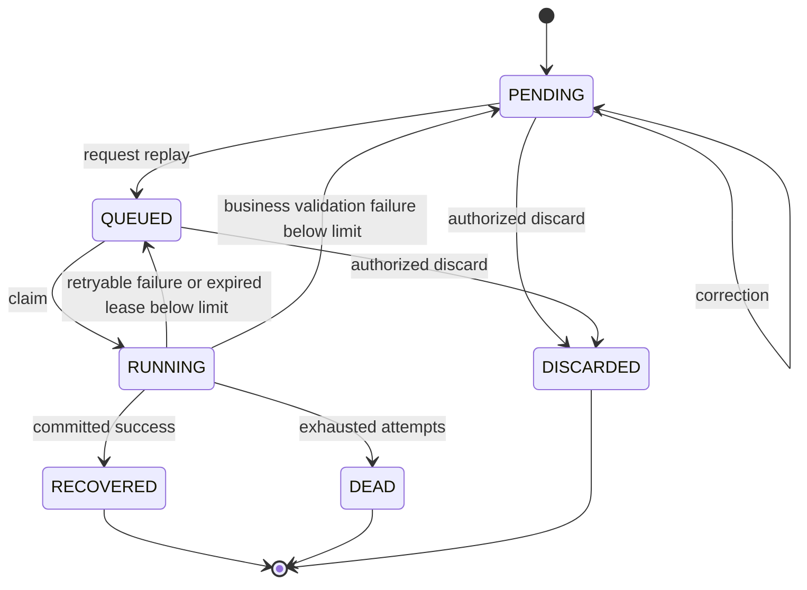

# Architecture and technical specification

Status: Sprints 0–8 merged, developer experience under review (Sprint 9). Version target: 0.1.0.

## 1. Goals and non-goals

Capture terminal, explicitly configured processor skips in a single-process Spring Batch job; store a versioned safe payload; allow correction and targeted replay via a registered handler. Original Spring Batch job status and counts remain unchanged. Do not replay filtered items (processor returns null), transient failures that later succeed, or unskipped fatal failures. Do not dynamically load arbitrary Java types from stored JSON.

MVP uses Java 21, Spring Boot 4.0.9 and Spring Batch 6.0.6. The core is independent of storage. Memory is volatile and nontransactional. JDBC supports PostgreSQL 16, MySQL 8.4, Oracle Free 23 and native H2 2.4, verified on real engines. Other dialects need their own tests. No REST exposure, dashboard, automatic listener weaving, partitioned/remote steps, read or write replay, or cross-database atomicity in the first slice. Spring Batch 5.2 support can be a separate adapter. 
   
## 2. Module boundaries

```mermaid
flowchart TD
  A[Spring Batch processor skip] --> B[Opt-in capture adapter]
  B --> C[Core rejection service]
  C --> D[Storage ports in core]
  D --> E[Optional JDBC adapter (4 dialects)]
  D --> M[Bounded memory adapter]
  D --> X[Custom implementation]
  F[Local Java recovery API] --> G[Recovery coordinator]
  G --> D
  G --> H[Application replay handler]
  I[Boot starter] -. wires .-> B
  I -. wires .-> G
```

- batchrecover-core: domain records, state machine, ports, policies; no Spring dependency.
- batchrecover-storage-memory: bounded single-JVM, volatile storage, no external runtime dependencies beyond core.
- batchrecover-storage-jdbc: optional dialect-aware JDBC repository, offline migrations, transactions and locking.
- batchrecover-spring-batch: opt-in SkipListener adapter and step-context mapping.
- batchrecover-spring-boot-starter: conditional bean configuration and property validation; no job launch or schema changes by default.
- batchrecover-examples: runnable sample with one customer import and one replay handler.
- batchrecover-coverage: internal aggregate coverage, not a runtime dependency.
- No web, UI or ORM modules in the library roadmap.

## 3. Capture semantics

Register a typed SkipListener on each selected step. Capture onSkipInProcess only. Retryable errors and filtered records do not create rejection records. Resolve job instance, job execution, step execution and configured step name. The application must provide a stable source record occurrence ID within the job instance (a business key alone may collide, e.g. repeated CSV rows; include source identity and offset). No identity inferred from object hash or mutable payload.

For transactional JDBC mode, persist with the same DataSource and transaction manager as the original chunk; reject unsupported configurations. Capture must participate in the chunk transaction, not REQUIRES_NEW. If the chunk rolls back, the rejection rolls back. On a later successful retry/restart, capture can occur again. Enforce uniqueness on application scope + job instance + logical step + source occurrence + phase; store execution IDs as provenance, not identity. Portable dialects use a canonical identity digest and verify the full tuple; PostgreSQL retains the original unique constraint. Insert idempotently, never overwrite original data on duplicate; unexpected content mismatch must surface as an invariant failure. Fail the step if capture cannot be persisted (fail closed), rather than silently losing a skip. Verify actual callback behavior against the pinned Spring Batch version with integration tests; do not assume identical semantics across 5.x and 6.x.

Explicit memory mode captures observed skips without transaction participation. It cannot roll back with a chunk or persist beyond JVM exit. Replay only after the host verifies completed input processing. Resourceless jobs must use a unique input occurrence prefix or fresh one-shot storage. See [storage](storage.md).

Read callbacks provide a Throwable, not necessarily the source payload. Write callbacks receive the output rather than the original input; moreover Spring Batch 6 scanning can roll back the callback transaction. Both require a dedicated design, version-specific tests and an explicit payload/commit strategy before enabling replay. Do not advertise them as supported.

## 4. Java interfaces

Current core interfaces; public API remains pre-release.

```java
public interface RecordIdentity<T> {
    String sourceOccurrenceId(T item);
}

public interface PayloadCodec<T> {
    String typeId();
    int schemaVersion();
    String encode(T item);
    T decode(String payload, int version);
}

public interface RecoveryHandler<T> {
    void validate(T item, RecoveryContext context);
    void replay(T item, RecoveryContext context);
}
```

RecoveryContext exposes rejection ID, stable operation idempotency key and attempt metadata. Register handler IDs and codecs explicitly; no reflection-driven arbitrary execution. Validate corrected payload at the application boundary and again on replay. Handler owns business semantics; do not call a generic original ItemWriter automatically. The example uses a transactional JDBC upsert, not an external API.

The optional RecoveryStorage interface combines the existing two repository ports and exposes capabilities, plus an application-scoped pending query. No core dependency on drivers, Spring or vendor dialects.

## 5. Persistence model (logical)

| Table | Key data |
| --- | --- |
| br_rejection | UUID, app scope, job instance/execution IDs, step execution ID/name, source occurrence ID, phase, error code/category, handler ID, payload type/schema version, status, attempt count, max attempts, next attempt at, lease token/expiry, version, timestamps |
| br_payload_revision | rejection ID + revision number, safe immutable payload, schema version, changed by, reason, created at |
| br_recovery_attempt | attempt UUID, rejection ID, revision, lease/fencing token, start/end time, outcome, sanitized error |
| br_audit_event | event UUID, rejection ID, action, actor, reason, prior/new status, timestamp |

Unique rejection identity as above. Payload revision 0 is original. Correction appends a new revision; it never modifies revision 0. Foreign keys, check constraints for states and nonnegative counters, indexes on status/next attempt and lease expiry. Timestamps UTC. No foreign key to Spring Batch metadata (retention can differ). Use namespaced explicit versioned SQL migrations, applied by the consuming application before enabling the feature. Payload retention must cover all revisions and backups through the host's policy.

## 6. State machine



Correction and replay requests require optimistic version checks; never correct an active queued/running record. Queueing is explicit. Retryable errors use bounded exponential backoff with jitter. Business validation failures require correction. All unsuccessful claims consume a budget; exhausted attempts become DEAD, not silently reset. DEAD reset/reopen is a later feature. Status changes and corresponding audit entries commit atomically.

## 7. Concurrency and recovery transactions (JDBC)

1. Short claim transaction: select eligible QUEUED rows ordered by due timestamp and UUID using FOR UPDATE SKIP LOCKED. Update state, lease token, expiry, attempt counter and append attempt/audit; commit. A reaper handles expired RUNNING leases, consuming the already allocated attempt and respecting limits.
2. Per-item execution transaction: lock the rejection by ID, validate state, fencing token and lease at start, select the pinned revision, validate and execute the application-owned handler with the same JDBC transaction. Hold the row lock through execution; configure bounded transaction/statement timeouts. Commit effect, RECOVERED and audit together. Reaper cannot reclaim a locked running row.
3. On handler error roll back execution. In a separate short transaction, check the same token, record sanitized failure, and transition to PENDING, QUEUED or DEAD. If the process crashes before failure recording, the reaper handles expiry. Stale tokens must never finalize newer claims.

The stable idempotency key represents the intended business operation, not an attempt or corrected revision; the handler must enforce business uniqueness. Atomic local effects require the same physical transaction and no autonomous writes. External HTTP calls, multiple databases and asynchronous side effects are out of MVP: an outbox plus downstream idempotency may be added later. No universal exactly-once claim.

Memory mode uses a single-JVM metadata lock and per-record execution fence, not JDBC transactions. Handler exceptions do not undo effects; use synchronous idempotent handlers. Capabilities and capacity limits are documented in [storage](storage.md).

## 8. Security and observability

Disabled by default; explicit step enrollment and payload allowlist, size limit and sensitive-field handling. The host supplies a replayable approved payload or a durable safe reference; masking alone may make replay impossible. Never persist arbitrary exception stack traces, secrets, raw credentials or unsanitized messages. Disable unsafe polymorphic JSON deserialization. Actor and authorization are application-owned in local API; host applications exposing the API to users must enforce authorization and scoped access. Avoid high-cardinality metric labels and never include payloads in logs. Optional Micrometer worker timers use bounded outcome tags. Other metrics remain future work if needed. Retention and access controls required before production use.

## 9. Compatibility and decision records

- ADR-001: use Spring Batch 6 / Boot 4 for a new project; 5.2 adapter later. Support for 5.2 is outside this verified release matrix.
- ADR-002: capture processor skips only in the first release; prove rollback safety before adding other phases.
- ADR-003: JDBC and PostgreSQL first, favor explicit transaction semantics over ORM abstractions.
- ADR-004: replay handler is explicit and registered; no arbitrary job restart.
- ADR-005: Local Java API only; no REST/dashboard in the library roadmap. 
- ADR-006: Apache-2.0 adopted by the owner; io.github.hamzador verified in Central Portal. Publication requires separate approval.
- ADR-007: Storage contracts in core, bounded memory and optional JDBC; no silent fallback or speculative providers.

## References

- [Spring Batch 6 migration guide](https://github.com/spring-projects/spring-batch/wiki/Spring-Batch-6.0-Migration-Guide)
- [Spring Batch skip configuration](https://docs.spring.io/spring-batch/reference/step/chunk-oriented-processing/configuring-skip.html)
- [Spring Batch 6.0.4 and 5.2.6 announcement](https://spring.io/blog/2026/06/10/spring-batch-6-0-4-and-5-2-6-available-now/)
- [PostgreSQL locking clause](https://www.postgresql.org/docs/current/sql-select.html)
